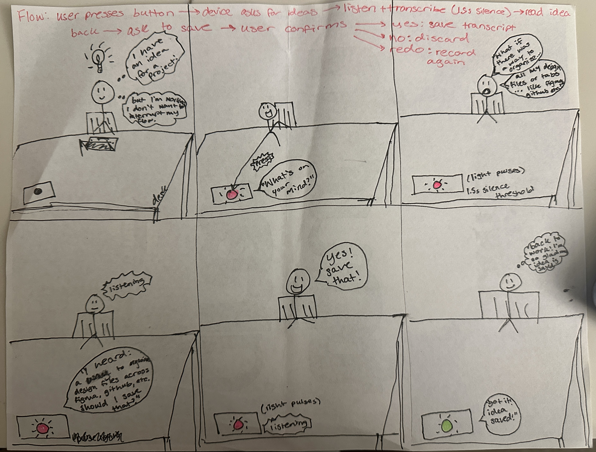

# Chatterboxes

**NAMES OF COLLABORATORS HERE**

[](https://youtu.be/LZ0VJClIlRI?si=Yy84mcyVYuVV19mn)

In this lab, we want you to design interaction with a speech-enabled device — something that listens and talks to you. This device can do anything *but* control lights (since we already did that in Lab 1). First, we want you to storyboard what you imagine the conversational interaction to be like. Then you will use wizarding techniques to elicit examples of what people might say, ask, or respond. We then want you to use the examples collected from at least two other people to inform the redesign of the device.

We will focus on **audio** as the main modality for interaction to start; these general techniques can be extended to **video**, **haptics** or other interactive mechanisms in the second part of the Lab.

A note on what you are building with. Speech interfaces are usually taught as two boxes — speech-in, speech-out — and that framing hides the part that actually determines whether an interaction works. Between listening and speaking sits the question of **whose turn it is**: when does the device decide you have finished talking, and how long does it make you wait before it answers? This lab gives you direct control over both, and we will ask you to notice what changes when you move them.

## Prep for Part 1: Get the Latest Content and Pick up Additional Parts

Please check instructions in [prep.md](prep.md) and complete the setup.

### Pick up Web Camera If You Don't Have One

Students who have not already received a web camera will receive their Webcam and at the beginning of lab. If you cannot make it to class this week, please contact the TAs to ensure you get these.

### Get the Latest Content

As always, pull updates from the class Interactive-Lab-Hub to both your Pi and your own GitHub repo.

**\[recommended\]** Option 1: On the Pi, `cd` to your `Interactive-Lab-Hub`, pull the updates from upstream (class lab-hub) and push the updates back to your own GitHub repo. You will need the *personal access token* for this.

```
pi@ixe00:~$ cd Interactive-Lab-Hub
pi@ixe00:~/Interactive-Lab-Hub $ git pull upstream Fall2026
pi@ixe00:~/Interactive-Lab-Hub $ git add .
pi@ixe00:~/Interactive-Lab-Hub $ git commit -m "get lab3 updates"
pi@ixe00:~/Interactive-Lab-Hub $ git push
```

Option 2: On your own GitHub repo, create a pull request to get updates from the class Interactive-Lab-Hub. After you have the latest updates online, go to your Pi, `cd` to your `Interactive-Lab-Hub` and use `git pull`.

---

# Part 1

## Setup

Create and activate a virtual environment for this lab:

```
pi@ixe00:~$ cd Interactive-Lab-Hub/Lab\ 3
pi@ixe00:~/Interactive-Lab-Hub/Lab 3 $ python3 -m venv .venv
pi@ixe00:~/Interactive-Lab-Hub/Lab 3 $ source .venv/bin/activate
(.venv) pi@ixe00:~/Interactive-Lab-Hub/Lab 3 $
```

Install the Python dependencies:

```
(.venv) $ pip install -r requirements.txt
```

This takes a few minutes. If you would like it to take considerably less time, [`uv`](https://docs.astral.sh/uv/) is a drop-in replacement for `pip` that is dramatically faster on the Pi:

```
(.venv) $ pip install uv && uv pip install -r requirements.txt
```

Then run the setup script, which installs the classic speech synthesizers, downloads the voice activity detection model, and pre-fetches a neural voice and a speech recognition model so you are not waiting on downloads during lab:

```
(.venv):~$ cd speech-scripts
(.venv) $ ./setup.sh
```

Check your audio devices before going further. `arecord -l` lists capture devices and `aplay -l` lists playback devices; if your webcam microphone or Bluetooth speaker does not appear, fix that first — every script below assumes the system defaults are the ones you want.

## A. Text to Speech

Your Pi can speak in several quite different ways, and the differences are audible in a way that matters for design. In `speech-scripts/` there are shell scripts for each.

### The classic engines

```
(.venv) $ cd speech-scripts

(.venv) $ sudo apt update
(.venv) $ sudo apt install -y espeak festival festvox-kallpc16k

(.venv) $ ./espeak_demo.sh
(.venv) $ ./festival_demo.sh
```

You can run these `.sh` files by typing `./filename`, and read one with `cat filename`. You can also play audio files directly with `aplay filename` — try `aplay lookdave.wav`.

These are all decades-old technology and they sound like it. `espeak-ng` is a *formant synthesizer*: it generates speech from an acoustic model of the vocal tract, which is why it sounds robotic but also why the whole thing fits in a couple of megabytes and responds instantly. `festival` is *concatenative*: they stitch together recorded fragments of a real speaker, which sounds more human but breaks audibly at the seams.

### Neural TTS with Piper

Note that the Piper command line changed in version 1.x — voices are now downloaded explicitly with `python3 -m piper.download_voices`, and you invoke it as `python3 -m piper`. Tutorials you find online may show the old `echo ... | piper --model ...` form, which no longer works. Browse the [voice samples](https://rhasspy.github.io/piper-samples) and download a different one if you'd like:

```
(.venv) $ python3 -m piper.download_voices en_US-lessac-medium
```

[Piper](https://github.com/OHF-Voice/piper1-gpl) synthesizes speech with a small neural network, runs comfortably on the Pi 5, and sounds markedly better than the above.

```
(.venv) $ ./piper_demo.sh
```

The demo script also shows `--output-raw`, which streams audio to the speaker as it is generated rather than writing a file first. Listen for the difference in how quickly speech begins. In a conversational system this gap is the thing your user experiences as responsiveness.

\*\***Write your own shell file to use your favorite of these TTS engines to have your Pi greet you by name.**\*\*
(This shell file should be saved to your own repo for this lab.)

\*\***Then answer: Is the same greeting, in these different voices, the same greeting? Describe one concrete way the voice changed what the utterance seemed to mean or who seemed to be speaking.**\*\*
Although the words themselves stay the same, the voice changes how the greeting is interpreted. eSpeak's mechanical, robotic speech makes it feel more like an automated command or notification than a personal greeting. Festival sounds somewhat more human, but its speech still feels synthesized. Piper's neural voice sounds more natural and conversational, making the device seem friendlier and more personable. This demonstrates how voice synthesis can influence a user's perception of a device's personality and intentions, even when the spoken content remains unchanged.

## B. Speech to Text

We use [faster-whisper](https://github.com/SYSTRAN/faster-whisper), a reimplementation of OpenAI's Whisper model that runs several times faster on CPU and does not require PyTorch. All processing happens on the Pi; nothing is sent to a server.

```
(.venv) $ python transcribe.py lookdave.wav
```

The transcript is not the interesting output here — the timings are. Run it again with a larger model and compare:

```
(.venv) $ python transcribe.py lookdave.wav --model base.en
(.venv) $ python transcribe.py lookdave.wav --model small.en
#  noted that the first run may take longer because the model is downloaded, and that the HF unauthenticated-request warning is expected and not an error.
```

Available sizes, smallest first: `tiny.en`, `base.en`, `small.en`, `medium.en`. The `.en` variants are English-only and faster than their multilingual counterparts at the same size.
I tested three Whisper model sizes on the same 3.72-second audio recording. All three produced the same correct transcription, but processing times increased significantly with model size. The tiny model had an RTF of 0.36x, base had 0.61x, and small had 1.57x. For this recording, the larger models didn't provide any accuracy improvement despite taking longer to process. This suggests that a smaller model might be better suited to a conversational device where response time matters.

\*\***Record a few seconds of your own speech (`arecord -d 5 -f cd -c 1 -r 16000 test.wav`) and transcribe it with at least two model sizes. Report the real-time factor for each. At what point does the accuracy improvement stop being worth the delay, for a system that has to answer you?**\*\*
I recorded a 5-second clip of myself speaking and tested it with three Whisper models.

| Model | Transcription Time | Real-Time Factor |
| tiny.en | 1.23s | 0.25x |
| base.en | 2.20s | 0.44x |
| small.en | 6.23s | 1.25x |

All three models produced the same words, with only a minor punctuation difference in the small model. The tiny model was the fastest, while the small model took longer than the recording itself to process. For this example, increasing the model size didn't provide any meaningful improvement in transcription, so I think the additional delay stops being worthwhile beyond tiny.en. For a conversational device, I'd prioritize responsiveness over a slightly more sophisticated model when the transcription is already accurate.

\*\***Write your own script that verbally asks for a numerical input (a phone number, zipcode, number of pets) and records the answer the respondent provides.**\*\* Numbers are a good stress test — transcription systems make characteristic errors on digit strings, and you will want to know what they are before you design around them.
I created a shell script called `phone_input.sh` that uses eSpeak to verbally ask the user for their 10-digit phone number, records their response using the microphone, and transcribes it using Whisper's tiny.en model.

When I tested it, Whisper correctly recognized all 10 digits, but separated them into inconsistent groups rather than formatting them as a phone number. The transcription took 0.96 seconds, with a real-time factor of 0.12x.

This showed me that even when speech recognition accurately identifies numerical information, the formatting might still need additional processing before the system can reliably use it.

## C. Turn-taking: knowing when someone has stopped talking

Everything so far has worked on fixed audio files. A real conversational device does not get told when to start and stop recording — it has to decide. This is the problem that makes speech interfaces hard, and it is mostly not a speech recognition problem.

We use a **voice activity detector** (VAD) to segment the microphone stream into utterances. `listen.py` runs Silero VAD continuously and hands each detected utterance to faster-whisper:

```
(.venv) $ cd speech-scripts
(.venv) $ python listen.py
```

Speak, pause, and watch it transcribe. Now change the endpointing threshold — the amount of silence the system requires before it decides your turn is over:

```
(.venv) $ python listen.py --min-silence 0.2
(.venv) $ python listen.py --min-silence 1.5
```

\*\***Try both extremes, and something in between. Describe what each one feels like to talk to. Note specifically: at 0.2s, what kinds of normal speech get cut off? At 1.5s, what does the delay make the system seem like?**\*\*

There is no correct value. A system that takes drink orders and a system that listens to someone think out loud want very different thresholds, and the right one depends on what your users are doing with their pauses.

At 0.2 seconds, I actually had a better experience than with the default 0.4-second setting. It recognized most of what I said accurately and seemed pretty responsive. It still broke up my sentences at natural pauses, like separating "and I'm trying to figure out" from the rest of my thought, but it didn't feel as disruptive as I expected. There were a few transcription mistakes, although overall it performed surprisingly well.
At 0.7 seconds, the system seemed better at keeping longer phrases together, but it still split up some of my thoughts. It also made some interesting transcription errors, like hearing "Elena" instead of "Alina" and "and pointing" instead of "endpointing." Increasing the silence threshold didn't necessarily improve transcription accuracy, although it did seem to give me more room to pause between words.
At 1.5 seconds, the system was much better at letting me finish my thoughts without splitting everything into separate transcriptions. It even captured a 13-second stretch of speech where I paused to think about what to say next. This felt more suited to an open-ended conversation where someone might need time to formulate their thoughts. The trade-off is that the system has to wait longer before responding, which could feel unnecessarily slow for simple questions or commands. It still made a few transcription mistakes, but overall I liked how much more conversational the interaction felt.

Overall, I found that the shorter thresholds felt more responsive, but they were also more likely to split my speech at natural pauses. Interestingly, 0.2 seconds actually performed pretty well in my test, despite being the shortest setting. At 0.7 seconds, the system kept some longer phrases together but still interrupted my train of thought. At 1.5 seconds, it allowed me to speak more naturally and pause while thinking. I think the best threshold depends on the interaction: shorter pauses make sense for quick commands, while longer ones are better for open-ended conversations.

### The complete loop

`echo_bot.py` puts the pieces together: it listens, endpoints, transcribes, and speaks a reply through Piper. The dialogue policy is deliberately trivial — it repeats what you said — so that everything you notice is a property of the timing rather than the content.

```
(.venv) $ python echo_bot.py
```

I tested `echo_bot.py`, which combines speech detection, transcription, and text-to-speech to repeat what the user says. The system successfully recognized my speech and responded verbally using Piper.

The speech recognition took 1.40 seconds, and the first audio response took another 0.21 seconds, for a total processing gap of 1.61 seconds. It misheard "Hi Pi" as "Hi bye," but otherwise transcribed my sentence correctly.

The response felt a little fast to me, especially compared to the more relaxed interaction I experienced with the 1.5-second silence threshold. I think a slightly longer pause before responding could make the interaction feel more natural for casual conversations.

## D. Storyboard

Storyboard and/or use a Verplank diagram to design a speech-enabled device. (Stuck? Make a device that talks for dogs. If that is too stupid, find an application that is better than that.)

\*\***Post your storyboard and diagram here.**\*\*

Write out what you imagine the dialogue to be. Use cards, post-its, or whatever method helps you develop alternatives or group responses.



\*\***Please describe and document your process.**\*\*

Your script should include the pauses. Where does your device wait, and for how long? You now know from Part C that this is a parameter you have to choose, not something that happens for free.

I wanted to design something that makes it easier to capture ideas as they come up, especially when I'm in the middle of doing something else and don't want to interrupt my workflow. I started with the idea of a voice-controlled notepad, but added a conversational element where the device reads the idea back and asks for confirmation before saving it. Based on my testing in Part C, I chose a 1.5-second silence threshold for recording ideas so users have time to pause and think without being interrupted. I also added a physical button and pulsing light to indicate when the device is listening, along with a green light to confirm when an idea has been saved. I included options to save, discard, or redo a recording in case the device misunderstands something.

## E. Acting out the dialogue

Find a partner, and *without sharing the script with your partner* try out the dialogue you've designed, where you (as the device designer) act as the device you are designing. Please record this interaction (for example, using Zoom's record feature).

\*\***Describe if the dialogue seemed different than what you imagined when it was acted out, and how.**\*\*
The interaction was a little different from what I originally imagined. My participant expected to give the device an explicit command, like "save a note," rather than immediately describing her idea. This made me realize that my initial prompt might not be intuitive to someone using the device for the first time.

There was also some confusion around the button. She seemed unsure when to press it and pressed it multiple times, possibly because there wasn't any visual feedback indicating when the device was listening. I think adding a pulsing light or another clear indicator would make the interaction feel more intuitive.

Another interesting moment was when I repeated her idea back to her. She said "yes" before I could finish asking "Should I save that?" and then awkwardly repeated herself after I finished. This made the dialogue feel less natural than I expected and showed me that users might anticipate what the device is going to say instead of waiting for each prompt.

Overall, the test made me realize that the device needs clearer feedback about its current state, more flexibility in how users initiate interactions, and a more natural confirmation process.

[Watch IdeaDrop Wizard-of-Oz Test 1](IdeaDrop_WoZ_Test1.mov)

---

# Lab 3 Part 2

For Part 2, you will redesign the interaction with the speech-enabled device using the data collected, as well as feedback from part 1.

## Prep for Part 2

1. What are concrete things that could use improvement in the design of your device? For example: wording, timing, anticipation of misunderstandings.
2. What are other modes of interaction *beyond speech* that you might also use to clarify how to interact? In particular: how does someone know when the device is listening, and when it is thinking? You have a screen and an LED.
3. Make a new storyboard, diagram and/or script based on these reflections.
4. (optional) Integrate [input devices](inputs.md) in the system

## Prototype your system

The system should:
* use the Raspberry Pi
* use one or more sensors
* require participants to speak to it

*Document how the system works.*

*Include videos or screencaptures of both the system and the controller.*

## Test the system

Try to get at least two people to interact with your system. (Ideally, you would inform them that there is a wizard *after* the interaction, but we recognize that can be hard.)

Answer the following:

### What worked well about the system and what didn't?
\*\**your answer here*\*\*

### What worked well about the controller and what didn't?
\*\**your answer here*\*\*

### What lessons can you take away from the WoZ interactions for designing a more autonomous version of the system?
\*\**your answer here*\*\*

### How could you use your system to create a dataset of interaction? What other sensing modalities would make sense to capture?
\*\**your answer here*\*\*

<details>
  <summary><strong>Submission Cleanup Reminder (Click to Expand)</strong></summary>

  **Before submitting your README.md:**
  - This readme.md file has a lot of extra text for guidance.
  - Remove all instructional text and example prompts from this file.
  - You may either delete these sections or use the toggle/hide feature in VS Code to collapse them for a cleaner look.
  - Your final submission should be neat, focused on your own work, and easy to read for grading.
</details>
