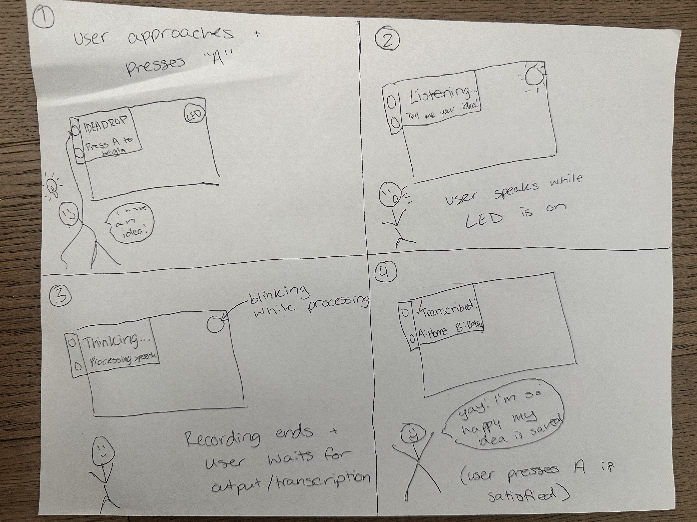

# Chatterboxes

**Alina Patel (ap2599)**

# Part 1

## A. Text to Speech

**I created a shell script using my preferred TTS engine to have the Raspberry Pi greet me by name.**

[View my greeting script](speech-scripts/alina_greeting.sh)

Although the words themselves stay the same, the voice changes how the greeting is interpreted. eSpeak's mechanical, robotic speech makes it feel more like an automated command or notification than a personal greeting. Festival sounds somewhat more human, but its speech still feels synthesized. Piper's neural voice sounds more natural and conversational, making the device seem friendlier and more personable. This demonstrates how voice synthesis can influence a user's perception of a device's personality and intentions, even when the spoken content remains unchanged.

## B. Speech to Text

**I recorded a 5-second clip of myself speaking and tested it with three Whisper models.**

| Model | Transcription Time | Real-Time Factor |
|-------|--------------------|------------------|
| tiny.en | 1.23s | 0.25x |
| base.en | 2.20s | 0.44x |
| small.en | 6.23s | 1.25x |

All three models produced the same words, with only a minor punctuation difference in the small model. The tiny model was the fastest, while the small model took longer than the recording itself to process. For this example, increasing the model size didn't provide any meaningful improvement in transcription, so I think the additional delay stops being worthwhile beyond tiny.en. For a conversational device, I'd prioritize responsiveness over a slightly more sophisticated model when the transcription is already accurate.

**I created a shell script called `phone_input.sh` that uses eSpeak to verbally ask the user for their 10-digit phone number, records their response using the microphone, and transcribes it using Whisper's tiny.en model.**

When I tested it, Whisper correctly recognized all 10 digits, but separated them into inconsistent groups rather than formatting them as a phone number. The transcription took 0.96 seconds, with a real-time factor of 0.12x.

This showed me that even when speech recognition accurately identifies numerical information, the formatting might still need additional processing before the system can reliably use it.

## C. Turn-taking: knowing when someone has stopped talking

At 0.2 seconds, I actually had a better experience than with the default 0.4-second setting. It recognized most of what I said accurately and seemed pretty responsive. It still broke up my sentences at natural pauses, like separating "and I'm trying to figure out" from the rest of my thought, but it didn't feel as disruptive as I expected. There were a few transcription mistakes, although overall it performed surprisingly well.

At 0.7 seconds, the system seemed better at keeping longer phrases together, but it still split up some of my thoughts. It also made some interesting transcription errors, like hearing "Elena" instead of "Alina" and "and pointing" instead of "endpointing." Increasing the silence threshold didn't necessarily improve transcription accuracy, although it did seem to give me more room to pause between words.

At 1.5 seconds, the system was much better at letting me finish my thoughts without splitting everything into separate transcriptions. It even captured a 13-second stretch of speech where I paused to think about what to say next. This felt more suited to an open-ended conversation where someone might need time to formulate their thoughts. The trade-off is that the system has to wait longer before responding, which could feel unnecessarily slow for simple questions or commands. It still made a few transcription mistakes, but overall I liked how much more conversational the interaction felt.

Overall, I found that the shorter thresholds felt more responsive, but they were also more likely to split my speech at natural pauses. Interestingly, 0.2 seconds actually performed pretty well in my test, despite being the shortest setting. At 0.7 seconds, the system kept some longer phrases together but still interrupted my train of thought. At 1.5 seconds, it allowed me to speak more naturally and pause while thinking. I think the best threshold depends on the interaction: shorter pauses make sense for quick commands, while longer ones are better for open-ended conversations.

### The complete loop

I tested `echo_bot.py`, which combines speech detection, transcription, and text-to-speech to repeat what the user says. The system successfully recognized my speech and responded verbally using Piper.

The speech recognition took 1.40 seconds, and the first audio response took another 0.21 seconds, for a total processing gap of 1.61 seconds. It misheard "Hi Pi" as "Hi bye," but otherwise transcribed my sentence correctly.

The response felt a little fast to me, especially compared to the more relaxed interaction I experienced with the 1.5-second silence threshold. I think a slightly longer pause before responding could make the interaction feel more natural for casual conversations.

## D. Storyboard

I wanted to design something that makes it easier to capture ideas as they come up, especially when I'm in the middle of doing something else and don't want to interrupt my workflow. I started with the idea of a voice-controlled notepad, but added a conversational element where the device reads the idea back and asks for confirmation before saving it. Based on my testing in Part C, I chose a 1.5-second silence threshold for recording ideas so users have time to pause and think without being interrupted. I also added a physical button and pulsing light to indicate when the device is listening, along with a green light to confirm when an idea has been saved. I included options to save, discard, or redo a recording in case the device misunderstands something.

## E. Acting out the dialogue

The interaction was a little different from what I originally imagined. My participant expected to give the device an explicit command, like "save a note," rather than immediately describing her idea. This made me realize that my initial prompt might not be intuitive to someone using the device for the first time.

There was also some confusion around the button. She seemed unsure when to press it and pressed it multiple times, possibly because there wasn't any visual feedback indicating when the device was listening. I think adding a pulsing light or another clear indicator would make the interaction feel more intuitive.

Another interesting moment was when I repeated her idea back to her. She said "yes" before I could finish asking "Should I save that?" and then awkwardly repeated herself after I finished. This made the dialogue feel less natural than I expected and showed me that users might anticipate what the device is going to say instead of waiting for each prompt.

All in all, the test made me realize that the device needs clearer feedback about its current state, more flexibility in how users initiate interactions, and a more natural confirmation process.

[Watch IdeaDrop Wizard-of-Oz Test 1](IdeaDrop_WoZ_Test1.mov)

---

# Lab 3 Part 2

1. What are concrete things that could use improvement in the design of your device? For example: wording, timing, anticipation of misunderstandings.

For IdeaDrop, I wanted to improve the clarity of the instructions and the feedback users receive throughout the interaction. The original recording window was fixed at 8 seconds, which could cut users off if they needed more time to explain their ideas. I also wanted to make it more obvious when the device was listening versus processing speech, and give users a way to retry if their idea was recorded or transcribed incorrectly.

2. What are other modes of interaction *beyond speech* that you might also use to clarify how to interact? In particular: how does someone know when the device is listening, and when it is thinking? You have a screen and an LED.

I wanted to use the PiTFT screen and LED to provide visual feedback alongside speech input. The screen could display different messages for each stage, like "Ready," "Listening," "Thinking," and "Transcribed." The LED could also turn on while recording and blink while processing, making the device's status easier to recognize. The PiTFT buttons would let users start recording, retry, or return to the home screen without needing additional voice commands. 

3. Make a new storyboard, diagram and/or script based on these reflections.

For my redesign, I focused on making IdeaDrop's different interaction states more obvious and giving users more control over the recording process. The storyboard shows the user starting a recording, speaking their idea, waiting for the device to transcribe it, and reviewing the result. I also incorporated visual feedback through the screen and LED to help users understand when the device is listening versus processing. After transcription, users can press A to return home or B to retry if their idea wasn't captured correctly.
 

4. (optional) Integrate [input devices](inputs.md) in the system

I used the PiTFT's physical buttons to control the interaction, allowing users to start recording or return to the home screen without voice commands. For a future iteration, I would like to separate the input from the device itself by introducing a small wireless handheld remote. This would let users record ideas more naturally without having to reach for the Raspberry Pi.

## Prototype your system

For my redesigned prototype, I expanded IdeaDrop's visual feedback and added more control over the recording process. The Raspberry Pi uses a USB microphone to capture speech, which is transcribed using Whisper. The PiTFT displays different states to indicate when the device is ready, listening, or processing speech. Users can then review their transcription, which automatically scrolls if it's too long to fit on the screen. They can press A to save their idea to a text file or B to record it again.

I also implemented a laptop-based Wizard-of-Oz controller that lets me trigger recordings, navigate between screens, and manually correct transcriptions. This allows me to simulate more accurate speech recognition and explore how users respond to the interaction. Although my initial storyboard included a physical LED to indicate when the device was listening or processing speech, I ended up using colored indicators directly on the PiTFT screen instead. Green indicates listening, yellow indicates processing or awaiting confirmation, and pink indicates the home screen. This allowed me to provide visual feedback without adding additional hardware, while keeping the interaction simple and easy to follow.

### IdeaDrop System Demonstration

The prototype demo below demonstrates my redesigned IdeaDrop prototype, including the listening and processing states, speech transcription, the option to record again, and confirmation when an idea is saved. 

I also created a laptop-based Wizard-of-Oz controller that lets me remotely control IdeaDrop through the terminal. I can initiate recordings, navigate between screens, and manually correct transcriptions before saving them, which allows me to simulate more accurate speech recognition while observing how users interact with the device. The controller demo demonstrates the controller triggering a recording, correcting the transcribed text, and saving the corrected idea.

[Watch the IdeaDrop prototype demo](ideadrop_demo_for_readme.mp4)

[Watch the IdeaDrop controller demo](ideadrop_controller_demo_for_readme.mp4) 

## Test the system

### What worked well about the system and what didn't?
Overall, both participants found IdeaDrop intuitive and easy to use. Wiam's only difficulty was initially figuring out which physical buttons corresponded to A and B. Nophar particularly liked the colored status indicator, which helped communicate what the device was doing. One limitation I noticed was that Nophar tried pressing the button again to stop recording early, but the system currently uses a fixed 10 second recording window. This showed me that the interface could benefit from clearer button labeling and more flexible recording controls.

### What worked well about the controller and what didn't?
The Wizard-of-Oz controller worked well for remotely triggering recordings and manually correcting transcriptions. I tested the correction feature with Nophar, and she liked being able to see the corrected result. One limitation was that the controller relied on typing commands in the terminal, which wasn't particularly convenient for making quick changes during an interaction. I also initially ran into issues with the terminal repeatedly printing screen updates, which made entering commands difficult until I adjusted the code.

### What lessons can you take away from the WoZ interactions for designing a more autonomous version of the system?
The biggest takeaway was that the system should be more responsive to users rather than relying on fixed timing. Nophar instinctively tried to stop the recording herself, so a future version could support pressing the button again to finish recording or use voice activity detection to recognize when someone has stopped speaking. The transcription correction feature also showed the value of allowing users to review and fix errors before saving. Also, Wiam's confusion with the buttons reinforced how important it is for the physical interface to match the on-screen instructions, or to provide labels if that is not naturally possible.

### How could you use your system to create a dataset of interaction? What other sensing modalities would make sense to capture?
IdeaDrop could collect audio recordings, transcriptions, timestamps, button presses, retries, and transcription corrections to create a dataset of user interactions. This could help identify common speech recognition errors, how long people typically speak, and where they encounter difficulties. Additional sensing modalities like ambient noise detection could help understand how environmental conditions affect transcription accuracy, while proximity or motion sensors could provide information about how users approach and interact with the device. Though, speech recordings and other identifiable data would only be collected with participants' consent.
