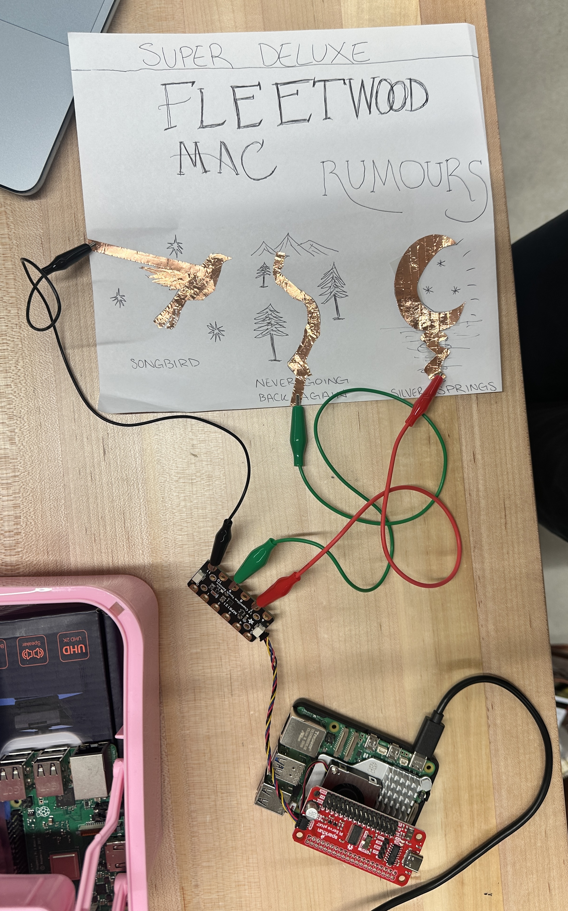
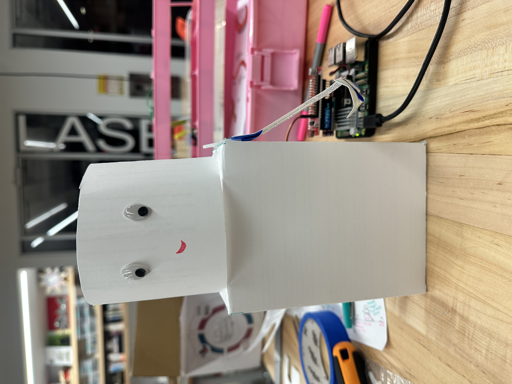
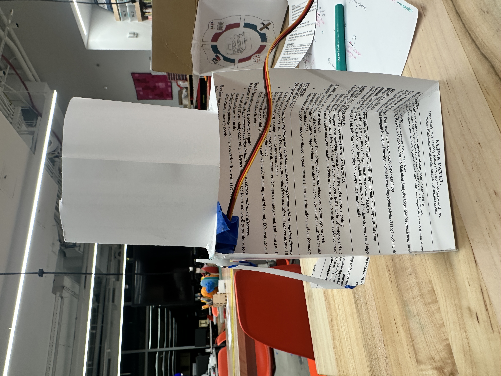

# Ph-UI!!!

---

---

## Lab Overview  
Members: Alina Patel (ap2599, @alinappatel)  
Project name: Drinking Buddy

For lab this week, we focus on both sensing and actuation, bringing new modes of input and output into your devices, while also prototyping the physical structure and overall look of the device. You will consider how the physical form supports sensing and actuation, and how these elements come together to shape the interaction and aesthetics of the device.

---

## Lab Structure

A) [Capacitive Sensing](#part-a)

B) [More Sensors](#part-b)

C) [Servo Actuation](#part-c)

D) [Physical Interaction Design: Feast Automata](#part-d)

E) [Build & Integrate](#part-e)

F) [Final Documentation](#part-f)

---

### Part A
### Capacitive Sensing, a.k.a. Human-Twizzler Interaction 

Parts Used: Raspberry Pi 5, MPR121 capacitive touch sensor, SparkFun Servo pHAT, Qwiic cable, copper tape, alligator clips, paper, Mac for audio playback.

For Part A, I made a touch-sensitive version of Fleetwood Mac's Rumours album cover. I wanted to explore how physical artwork could become an interface for music, rather than just using buttons on a screen.

I used an MPR121 capacitive touch sensor, copper tape, paper, and alligator clips to create three touch-sensitive areas, each corresponding to a song from Rumours (Super Deluxe Edition):

Pin 11: Songbird

Pin 9: Never Going Back Again

Pin 7: Silver Springs

I connected the MPR121 to my Raspberry Pi through the Servo pHAT's Qwiic connection. I first tested the individual contacts with cap_test.py, then wrote rumours_touch.py to detect when each area was touched and released.

Since I wanted the audio to play through my Mac, I created a separate Python controller that receives touch events from the Pi over SSH and controls the Music app using AppleScript.

Interaction: Holding a touch area plays its corresponding song. Releasing it pauses playback, and touching it again resumes the song from where it stopped. Touching a different area switches tracks.

Testing and Iteration

Initially, I tested the MPR121's contacts and then extended the touch inputs using copper tape. I also encountered an I²C connection issue where the sensor wasn't detected at address 0x5A, which I resolved by checking the physical connections.

For audio playback, my first version used afplay, but the music didn't pause correctly when I released the sensor. I switched to controlling Apple Music through AppleScript and adjusted the playback logic until the songs paused and resumed as intended.

The final prototype successfully connected touch and release gestures to music playback. I found it interesting how a simple conductive surface could turn a physical piece of artwork into a functional music interface.

##### Prototype Documentation

**Physical setup:**

**Working prototype:**

[Watch the Rumours interaction demo](rumours_demo_compressed.mp4)

**Code:**
- [Raspberry Pi touch detection](rumours_touch.py)
- [Mac audio controller](rumours_player.py)

---

### Part B
### More sensors

#### Light/Proximity/Gesture sensor (APDS-9960)

Parts Used: Raspberry Pi 5, SparkFun Servo pHAT, Qwiic cables, APDS-9960 proximity/gesture/color sensor, Adafruit rotary encoder with NeoPixel, SparkFun VCNL4040 proximity sensor, SparkFun Qwiic joystick.

I connected the APDS-9960 to my Raspberry Pi using a Qwiic cable and tested its three sensing capabilities.

Proximity: The readings ranged from 0 to 255 as I moved my hand toward the sensor. It worked, although the detection range was shorter than I expected.

Gesture: The sensor successfully recognized up, down, left, and right swipes. I found that the gestures had to be performed fairly close to the sensor to register.

Color/light: The sensor output raw red, green, blue, and clear light values, as well as estimated color temperature and brightness. I observed the brightness values change significantly when the sensor received less light.

#### Rotary Encoder 

I connected the rotary encoder through Qwiic and ran encoder_test.py. Rotating the knob changed the reported position in both directions, and pressing the knob registered button press and release events. I also tested the rotary encoder's built-in NeoPixel LED by creating [NeoPixel LED test code](encoder_led_test.py). I programmed it to glow pink using RGB values `(255, 80, 160)` and confirmed that the LED lit up successfully.

#### Joystick 

I tested the SparkFun Qwiic Joystick using joystick_test.py. The X and Y values stayed around 510–511 when the joystick was centered and changed between 0 and 1023 as I moved it in different directions. Pressing the joystick also changed the button value from 1 to 0. Both the directional controls and button worked successfully.

#### Distance Sensor

I tested the SparkFun distance/proximity sensor using qwiic_distance.py. The readings stayed around 0 to 3 when nothing was nearby and increased up to 553 when I moved my hand toward it. Unlike the APDS-9960, this sensor provided a wider range of proximity values rather than a 0 to 255 reading.

---

### Part C
### Servo Actuation

Parts Used: Raspberry Pi 5, SparkFun Servo pHAT, 9g micro servo, USB-C power supplies.

I tested the servo using pi_servo_hat_test.py and got it to rotate back and forth between 0° and 120°. The movement worked smoothly, and stopping the program returned it to its center position.

---

### Part D
### Physical Interaction Design: Feast Automata

**Feast Automata:** build a device that **transforms ordinary dining rituals into playful physical interactions.** Begin with a familiar experience around eating, drinking, cooking, serving, or sharing food, and explore how sensing and actuation might augment, exaggerate, automate, or reinterpret your dining experience.

In this part, use the sensing techniques from Parts A–B and the servo actuation from Part C to develop a physical interaction.

**Drinking Buddy Design Exploration**

 

For Feast Automata, I explored Drinking Buddy (Pour Me Up!), a small tabletop character that reacts when someone takes a shot. I sketched five possible mechanisms: a shoulder-mounted arm that raises a cup, a rotating body that turns to cheers, a rotating platform that brings a shot to the character, a two-servo arm that mimics drinking, and a “Limit Buddy” that initially cheers but eventually refuses and shakes its head.

**Questions Raised & Physical Prototyping**

The sketches raised questions about how to make Drinking Buddy's movements feel natural and expressive, where to mount the servos, and how much weight they can support. Can a single servo raise a shot glass convincingly? Could a two-servo arm mimic drinking, or could two servos control the arm and head separately? I also want to test whether the VCNL4040 proximity sensor can reliably detect a glass being lifted and whether copper tape with the MPR121 can detect liquid being poured into a glass.

To answer these questions, I would prototype the moving parts with cardboard, experiment with servo placement and angles to keep the character stable, and test different sensor positions to see what works reliably.

**Selected Design: Drinking Buddy with Cheers Arm** 

I chose Sketch 1, the moving-arm Drinking Buddy, because it felt like the most feasible design to prototype with the hardware I had available. When the user lifts their shot glass, a proximity sensor detects the movement and triggers a servo to raise the buddy's own tiny glass in an excited cheers. I want to experiment with the speed and repetition of the arm movement to give the character an overly enthusiastic personality.

I also liked Sketch 3's rotating shot platform, but it would require a more complicated mechanism and further testing of the capacitive sensing. The moving-arm design lets me focus on making a simple interaction feel playful and expressive.

**Cardboard Prototype**

I built a hollow cardboard body with a cylindrical head and left the back open so I could access the electronics. I mounted the servo at the shoulder using tape so I could reposition it if needed, and attached a lightweight cardboard arm with a tiny paper shot glass to the servo horn.

*Front View*

*Back View — Construction*

---

### Part E

#### Drinking Buddy — Working Prototype

**Parts Used:** Raspberry Pi 5, SparkFun Servo pHAT, 9g micro servo + servo horn, VCNL4040 proximity sensor, Qwiic cable, Mini PiTFT, cardboard, hot glue, tape, and paper.

I connected the VCNL4040 proximity sensor through Qwiic and the servo to Channel 0 of the Servo pHAT. The proximity sensor sits underneath a cardboard coaster and detects when the user's shot glass is placed or lifted.

When the user lifts their glass, Drinking Buddy raises its own tiny shot glass to cheers, pauses briefly, and then lowers its arm. It waits until the glass is returned before responding to another lift.

**Interaction Flow**

Glass on coaster → User lifts glass → Proximity sensor detects removal → Raspberry Pi triggers servo → Buddy raises its shot → Buddy lowers its arm → Waits for glass to return

**Calibration & Testing**

I tested the proximity sensor with the glass on and off the coaster and adjusted the thresholds based on its readings. Moving the electronics behind Drinking Buddy changed the readings, so I recalibrated the sensor. My final thresholds were 1095 for detecting the glass and 1092 for detecting its removal.

I also adjusted the servo horn and tested different angles to find the right movement. The servo rests at 80° and moves to 0° to raise the arm.

**Code:**
- [Final Drinking Buddy Interaction](drinking_buddy.py)
- [Manual Servo Calibration](drinking_buddy_manual.py)

**Terminal Output**

**Working Demo**

[Watch Drinking Buddy in action](drinking_buddy_final_demo.mp4)

**Reflection**

The biggest challenge was getting the servo to move the arm in the right direction. Initially, the arm kept swinging backward, so I had to reposition the servo horn and test different angles until it worked. I also learned how sensitive the proximity sensor was to physical placement, since moving the electronics meant I had to recalibrate it.

My favorite part was seeing the buddy actually respond when I lifted my glass! Even with a simple cardboard body and one moving arm, the interaction felt playful and gave the character a personality.

---

---

---

### Part F

#### Final Documentation — Drinking Buddy

**Looks Like:** A small tabletop cardboard character with a cylindrical head, googly eyes, and a moving arm holding a miniature shot glass. The body is hollow with an open back to access the servo and wiring.

**Works Like:** A VCNL4040 proximity sensor detects when the user's glass is lifted from its coaster. The Raspberry Pi then controls a servo that moves the buddy's arm from 80° (rest) to 0° (cheers) and back.

**Acts Like:** Drinking Buddy behaves like an overly enthusiastic friend who always wants to cheers with you. When the user lifts their shot glass, Buddy responds by raising its own, making a simple drinking ritual feel more playful.

---
